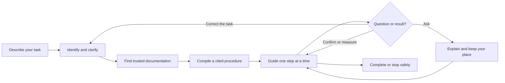
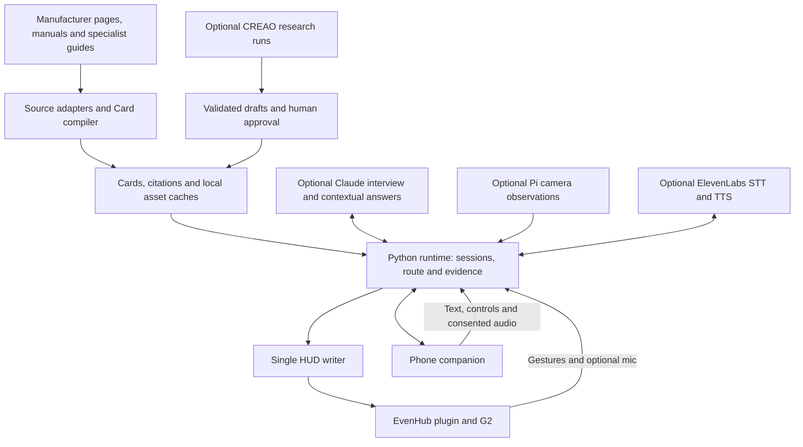

<div align="center">

# GhostBuild

### From knowledge to action.

An intelligent, hands-free specialist for the things you build and fix.<br>
Describe the task. Find the right guide. Keep your hands on the work.

[Try it locally](#try-it-locally) · [How it works](#how-it-works) · [Demo runbook](docs/DEMO_RUNBOOK.md) · [Engineering status](docs/FINAL_SPRINT_STATUS.md)


*Actual official G2 simulator output, not a photograph through the glasses.*

</div>

## Your hands are busy. Your guide should keep up.

You're holding a desk panel in place. The diagram is on your phone. To check the next screw, you put everything down, unlock the screen, zoom into a PDF, and find your place again.

Troubleshooting has the same problem: plenty of information, little help applying the right advice to the thing in front of you.

GhostBuild connects documentation to the task you're doing. It identifies the product, asks questions that change the next step, and brings a short instruction or useful diagram into view on Even Realities G2. The phone keeps the detailed explanation, sources, and conversation nearby.

**“Wait, where does this go?”** brings up the step's reference or a text fallback. **“That didn't work”** offers another documented check when the guide has one. Asking for help keeps your place; advancing a manual step records your confirmation, rather than pretending a sensor saw you finish.

## The experience

| Try saying | What the current implementation provides | Evidence and limits |
|---|---|---|
| “I'm building a white IKEA desk.” | Product-photo shortlist, identity confirmation, MICKE cabinet-side selection, 35-step manual guides and part diagrams. | Cached/manual-backed; browser and official simulator exercised. Authored wording still needs a human PDF spot-check. Other products can fall back to their official manual link. |
| “My MacBook screen turned green.” | A question about which screen is affected, followed by the corresponding Apple-support checks. | Cached, AI-compiled guide; live assistant and simulator evidence. This is troubleshooting, not an automatic diagnosis. |
| “I have a flat bicycle tire.” | Tube/tubeless clarification, valve identification, and a Park Tool-backed inner-tube procedure. | Cached, AI-compiled guide; tubeless repair stops rather than borrowing tube instructions. Source photographs need a local cache. |
| “My Prusa MK4 isn't extruding.” | Symptom branches backed by Prusa support, warnings and deliberate confirmation for hazardous actions. | Cached, AI-compiled, not human-reviewed. Model-specific; other models need new identification and sources. |

The same runtime also plays authored paper-cup, LED and Pi-camera setup cards. New tasks can use optional asynchronous source discovery and compilation. A recorded live Bosch filter-cleaning request produced a cited guide; that is evidence of one request, not a promise of universal coverage or response time.

[See the actual phone companion](docs/evidence/framework/phone-mac-color-filters.png) · [Inspect the source-to-action view](docs/evidence/framework/engine-page.png)

## How it works



The engineering is in the connection between these stages:

- **Questions choose a route.** Procedures contain actions, questions, choices, warnings, outcomes and stop conditions. Back navigation follows the route actually taken.
- **Sources become executable structure.** The compiler checks supporting quotations against fetched text, validates branch targets and cue lengths, and associates pictures with their source. These checks do not constitute human review or prove a repair is safe.
- **Help belongs to a step.** Context includes the current instruction, prior answers and confirmed progress. Short answers appear on G2; full answers can be paged and returned from explicitly.
- **Navigation stays local.** Once a card and its assets are available, gestures and picture retrieval do not need a model call. Optional interview, research and open questions use the backend.
- **Evidence keeps its meaning.** A wearer report is HUMAN CONFIRMED. A fresh camera frame is MEASURED LIVE. An interpretation is INFERRED. An LED command is COMMANDED.

## System architecture



**Even Realities** supplies the wearable display, SDK and interaction bridge. **Anthropic's official Python SDK** powers optional conversational reasoning, documented web search and source-to-action compilation; the configured default model is `claude-opus-5-5`. **CREAO** is a separate optional research-run engine, not the provider behind IKEA search. **ElevenLabs** supplies optional transcription and phone/earbud speech; G2 has no speaker.

The backend uses FastAPI, Pydantic contracts and local JSON/JSONL persistence. There is no required cloud database. See [architecture and trust boundaries](docs/ARCHITECTURE.md).

## Try it locally

Requires **Python 3.11**, **uv**, **Node.js 20 or later**, npm and Git. No glasses, Pi or API key is needed for the authored-guide path.

```sh
git clone https://github.com/tanushsavadi/GhostBuild.git
cd GhostBuild
make setup
make doctor
cp .env.example .env
make core
```

Open **http://localhost:8787/phone/**. Enter **“fold a paper cup”**, ask **“Where is that?”**, then use the phone controls to confirm a manual step. The mirror is browser output, not proof of a physical G2 connection.

The example environment disables paid/live providers. Cached text guides and bundled assets work locally; some compiled-guide pictures are deliberately excluded from Git and require fetching locally. [Setup](docs/SETUP.md) covers the simulator, live providers, hardware and packaging.

For the official simulator, keep the backend running and use two more terminals:

```sh
make g2-dev
```

```sh
cd g2
npm run simulate
```

For a phone/G2 build, set your actual reachable laptop address:

```sh
export BACKEND="http://$(ipconfig getifaddr en0):8787"
make g2-pack
```

This macOS command produces `g2/ghostbuild.ehpk` with the backend origin in its network whitelist. Use your LAN address explicitly on other platforms. Building the package does not install it or verify the device.

## Configuration and testing

Credentials belong only in the backend environment. Never put a provider key in `g2/`, a URL, or a screenshot. The server loads `.env` from the working directory. [The environment example](.env.example) documents feature switches; [setup](docs/SETUP.md#optional-providers) describes enabling them deliberately.

```sh
make test                         # contracts, generic lint, secret scan, Python, G2 types/Vitest
node --test web/tests/*.mjs        # companion logic and audio lifecycle
cd g2 && npm run build            # production TypeScript/Vite build
```

Tests and simulator runs establish software behavior. They do not establish microphone capture, BLE timing or physical-task correctness. [Final sprint status](docs/FINAL_SPRINT_STATUS.md) records actual results, live-provider evidence and remaining release gates; [physical acceptance](docs/ACCEPTANCE.md) is a separate checklist.

## Built for the limits of real glasses

G2 has **no camera and no speaker**. It does not see the wearer's surroundings. Optional Pi-camera evidence describes an external camera's fixed view only. Images are at most 288 × 144 pixels; a text fallback remains available if an image fails. Double press remains system exit.

Manual completion is **HUMAN CONFIRMED**. A step with a telemetry check requires measured evidence. AI-compiled guides remain labelled **not human-reviewed** until a person reviews them. Safety stops and source links remain part of the guide; the system cannot establish that an arbitrary physical repair succeeded.

Existing physical-session reports cover basic task/gesture traffic, but the final display, images, reconnection, microphone and head-shake behavior still require device acceptance. The Pi wiring document remains a template until someone records the actual build. We do not count simulator screenshots as hardware proof.

## Explore the repository

| Location | Responsibility |
|---|---|
| [`core/ghostbuild_core/`](core/ghostbuild_core/) | Sessions, procedure engine, assistant, evidence, HUD and API |
| [`contracts/`](contracts/) | Pydantic models, JSON schemas, generated TypeScript and examples |
| [`g2/`](g2/) | EvenHub renderer, transport, lifecycle, gestures and flagged microphone |
| [`web/`](web/) | Phone companion, sources, controls, conversation and audio |
| [`knowledge/`](knowledge/) | Cards, source fetch/compile tools, research imports and approval |
| [`integrations/ikea/`](integrations/ikea/) | Product records, official-page lookup and manual adapter |
| [`pi/`](pi/) / [`hardware/`](hardware/) | Optional external camera/LED station and physical setup records |
| [`docs/`](docs/) | Architecture, setup, evidence, demo and submission materials |

## Built at LA Hacks

GhostBuild was developed for LA Hacks AI Hackathon 2026. The repository history currently attributes commits to **Tanush Savadi**; [GitHub contributors](https://github.com/tanushsavadi/GhostBuild/graphs/contributors) is the public attribution record. The release documentation distinguishes authored demo cards, AI compilation, external documentation and live-provider tests. [Submission materials](docs/HACKATHON_SUBMISSION.md) map the product to the verified event tracks and sponsor requirements.

IKEA, Apple, Park Tool and Prusa documentation remains the property of its respective owners. References retain source links and attribution. Locally cached third-party photographs are not a reusable asset library; check permission before redistributing manuals, crops or screenshots containing them. A repository-wide source-code license is not yet included.

Next: finish physical-device acceptance, expand human-reviewed guides and source adapters, and make recovery across uncertain observations more dependable. The goal stays the same: **less time finding your place, more confidence taking the next step.**
