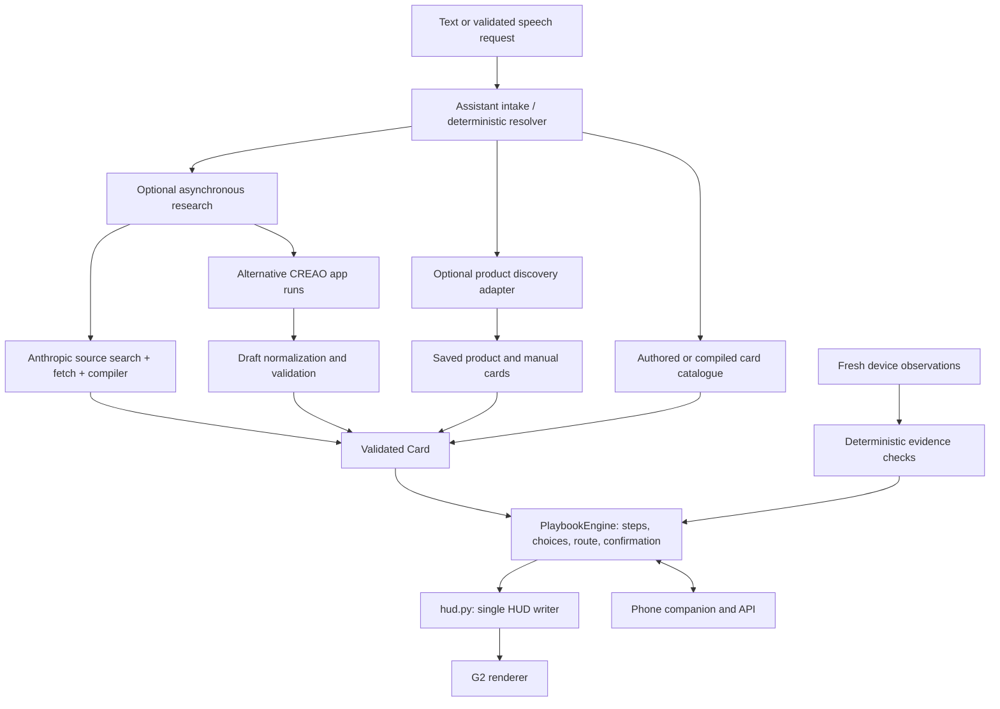

# GhostBuild architecture

GhostBuild turns documentation into stateful physical-task guidance. Its generic runtime consumes `Card` data; product knowledge belongs in cards and adapters. This describes the release implementation, including the later, explicitly enabled live-compilation path. Earlier numbered planning documents describe superseded designs.

## Two paths, one procedure engine

The **research path** identifies the task, fetches documentation and prepares a card. It may call paid providers. The **execution path** consumes that card, handles navigation and evidence, and renders the current instruction. Ordinary navigation and cached pictures make no model call.

## Responsibilities

| Component | Code | Responsibility |
|---|---|---|
| Contract | `contracts/models.py` | Card, step, choice, observation, session and HUD data; exported schemas/TypeScript |
| Source acquisition | `knowledge/find_sources.py`, `knowledge/sources.py` | Documented Anthropic web search; official/specialist preference; fetch numbered source text and source-owned images |
| Compiler | `knowledge/compile.py` | Structured graph output; quotation, route and cue validation; one repair attempt; optional source-photo crop/highlight |
| Product adapter | `integrations/product_discovery.py`, `integrations/ikea/` | Attach generic discovery to official IKEA records, photographs, article identity and manual bundles |
| Discovery state | `core/ghostbuild_core/discovery/` | Shortlists, confirmation, configuration, persistence and manual selection |
| Assistant | `core/ghostbuild_core/assistant/` | One-question intake, task context, grounded answers and step-owned help; deterministic commands precede model fallback |
| Execution | `core/ghostbuild_core/playbook.py`, `runtime.py` | Active route, manual progress, measured checks, contextual interruption and session coordination |
| Evidence | `tests.py`, `engine.py` | Deterministic telemetry checks and fault/recovery behavior |
| HUD | `hud.py` | Sole producer of HUD frames; asynchronous workers queue results rather than writing display state |
| Delivery | `server.py`, `g2/src/` | WebSocket with polling fallback; SDK renderer, sequence handling, lifecycle, serialized image sends and text fallback |
| Companion | `web/` | Current step, larger reference, source links, conversation, controls and consented audio |
| Optional device | `pi/ghostbuild_pi/` | External camera features and LED commands; not product identification or wearable vision |

The default conversational and compiler model in code is `claude-opus-5-5`, through the official `anthropic` SDK. IKEA live search uses `web_search_20250305` restricted to `ikea.com`, then validates candidates against their official pages. The model's proposed identity is not sufficient on its own.

## Card and route semantics

A card can contain a sequential playbook, a branching procedure and/or telemetry fault checks. Step kinds include actions, questions, outcomes and stops. Choices point to step IDs; source quotations, expected results, tools, warnings and risk accompany instructions.

- Manual steps advance on deliberate wearer confirmation and record HUMAN CONFIRMED.
- A `verify` step or telemetry recovery needs measured evidence; speech and gestures cannot substitute for it.
- Question answers choose a route and record a wearer report. Back follows the route taken.
- Hazardous actions ask for an additional confirmation. This is interaction protection, not a safety certification.
- Picture and answer requests preserve the current step. Paged answers return explicitly; delayed answers remain associated with their original context.

The compiler checks that quotations occur in fetched text and graph references resolve. It cannot prove that a quote entails every generated interpretation, that the source applies to a misidentified model, or that a physical operation succeeded. Compiled demo cards retain AI-COMPILED / NOT HUMAN-REVIEWED status.

## Research and review boundaries

There are three distinct acquisition flows:

1. **Authored/cached cards** load from `knowledge/cards/` and, by default, `knowledge/compiled/*/card.json`. Product-specific manual bundles load through the product adapter.
2. **Explicit CREAO research/review** (`GB_CREAO=1`) starts app-scoped research runs, normalizes returned artifacts, validates and stores drafts. Approval requires an admin token and reviewer name, then reloads cards. See `knowledge/creao.py` and `core/ghostbuild_core/research_runs.py`.
3. **Optional live research** (`GB_LIVE_RESEARCH=1`) uses `GB_RESEARCH_ENGINE=compile` by default or `creao` alternatively. Validated results can start as explicitly unreviewed guides. One active run and a per-process cap limit requests; results and provenance are retained for reuse. This path is intentionally different from human approval and does not confer it.

CREAO is not behind the default compiler or IKEA search. A key in `.env` proves neither connectivity nor an integration result. Historical live-run evidence and current verification status are recorded in [final sprint status](FINAL_SPRINT_STATUS.md).

## Transport and images

Core serves `/ws?role=g2`, `/hud`, `/hello` and `/input`; the plugin renders frames rather than deciding instructions. Reconnection sends session identity and restores the current frame. Failed connectivity replaces stale display content with an offline view. The renderer serializes awaited SDK sends and falls back to text when an image cannot be delivered.

Guides are available at `/guides/<id>/<view>.png`, with larger phone versions where present. G2 images are limited to 288 × 144. Reference photographs, cropped manual pages and generated menu-path drawings carry distinct provenance. A drawing of a menu path is not a screenshot or an observed outcome.

The companion is served at `/phone/`; `/phone/engine.html` explains the loaded catalogue through `/engine/summary`. `/state`, `/card`, `/catalog`, `/session/goal` and `/ask` support the shared experience. Interactive API documentation is available at `/docs` on a running FastAPI server.

## Voice and trust

ElevenLabs STT is opt-in (`GB_VOICE=1`); the G2 microphone additionally needs `VITE_FLAG_VOICE=1` in the build and the appropriate manifest permission. Speech enters the same validated control/intention path as typed input. Optional TTS (`GB_TTS=1` with a selected voice) plays through the phone or earbuds. G2 has no speaker.

Consent gates capture and provider processing. GhostBuild does not retain raw recordings; transcripts and session activity can appear in local logs. API keys stay in backend environment variables. Frontend `VITE_*` values are public build configuration and must never contain secrets. No final physical microphone, BLE or image-legibility result is implied by tests.

## Persistence and deployment limits

The implementation uses local files: session snapshots and discovery state beside the chosen log directory, JSONL event logs, reuse caches, research drafts/requests, and downloaded sources/images under ignored runtime paths. `knowledge/live/`, `knowledge/drafts/`, `knowledge/requests/`, `.env`, logs, build output and `.ehpk` packages are ignored by Git. There is no required hosted database.

The default server binds `0.0.0.0:8787` for the phone/Pi LAN demo. It is a local hackathon service with permissive CORS and shared task controls, not a multi-tenant internet service. Use a trusted network; production authentication, isolation and retention policy remain future work.

## Evidence vocabulary

| Label | Means |
|---|---|
| MEASURED LIVE | Fresh hardware observation, such as a received camera frame |
| INFERRED | Interpretation of features, such as an unobstructed external-camera view |
| COMMANDED | Output requested, such as GPIO high; light was not independently measured |
| HUMAN CONFIRMED | Wearer reports a condition or confirms completing a manual action |
| MANUFACTURER DOC | Source provenance; not a claim that a generated guide was manufacturer approved |
| AI-COMPILED / NOT HUMAN-REVIEWED | Code-validated generated guide, awaiting human review |
| REPLAY / SIMULATED | Recorded or synthetic inputs, always distinct from live hardware |

[Setup](SETUP.md) covers reproducible commands. [Physical acceptance](ACCEPTANCE.md) and [release status](FINAL_SPRINT_STATUS.md) distinguish software, simulator, provider and device evidence.
